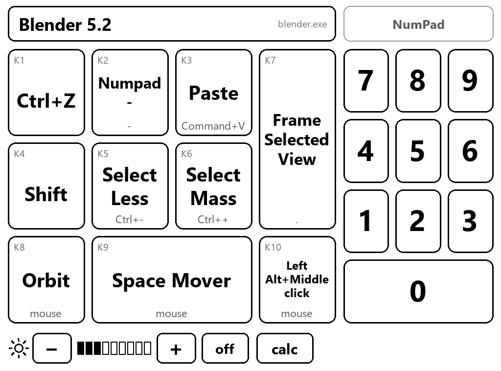
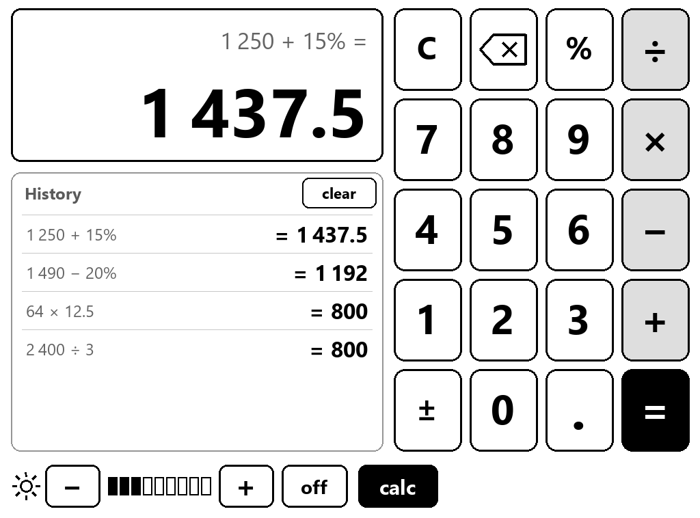

# inkondesk

An old jailbroken **Kindle Paperwhite 1** turned into a USB e-ink side screen for the desk.
I use it as an **info display** next to my XP-Pen Shortcut Remote — and the same setup can be adapted
into a **Stream Deck–style touch hotkey pad**.



## What it is

An old **Kindle Paperwhite 1** (2012, firmware 5.6.1.1, jailbroken) is connected to the PC with a single USB cable
and sits on the desk as a permanent e-ink screen. I use it as an **info display** next to the
**XP-Pen Shortcut Remote (ACK05)**:

- **left** — what the remote's K1–K10 keys do in the app that is active right now. The labels are read straight
  from the XP-Pen driver settings, and the profile follows the active Windows window (Blender, Krita, …) —
  no more digging through the driver's menus;
- **right** — my own touch buttons, for now a 0–9 numpad: tap a digit → the PC presses that NumPad key in the
  active app (in Blender these are the 1/3/7 views, 5 toggles perspective/ortho);
- **bottom** — frontlight `−` / `+` / `off`, and `calc`;
- **`calc`** — the whole screen becomes a calculator (tap `calc` again to go back to the key map, see below);
- **PC off or asleep** — after a minute the Kindle shows a screensaver and turns the light off; when the PC is
  back, the screen comes back by itself.

E-ink is a good fit: it doesn't glare, reads well in any light, and the picture stays even without power.

### Calculator



An ordinary calculator, drawn and computed by the PC program, so it works the same whatever app is active:

- `+ − × ÷` with the usual order (`2 + 3 × 4 = 14`), `±`, `C` (clear), `⌫` (delete the last digit);
- `%` works like on a desk calculator: after `+` or `−` it's a percent of what comes before
  (`1250 + 15% = 1437.5`, `1490 − 20% = 1192`), anywhere else it's just /100 (`64 × 10% = 6.4`);
- exact decimal arithmetic (`0.1 + 0.2 = 0.3`), up to 15 significant digits;
- **history** of finished calculations, newest on top: tap a line to use its result in the next calculation;
  `clear` empties it. The last 50 are kept in `xppen_kindle_state.json`, so they survive restarts.


## Make it your own Stream Deck

The setup already does the core of a touch hotkey pad: **draw buttons → catch a tap → run an action on the PC**.
So the screen can be turned completely into a **Stream Deck–like device**:

- drop the XP-Pen map and give the whole 758×1024 screen to a grid of your own buttons (e.g. 4×5 at ~180 px —
  a finger lands within ±30 px, so buttons from 120 px up are reliable);
- put anything on a button: a key combination (`Ctrl+Shift+…`), a string of text, launching an app, a script,
  an HTTP request to Home Assistant — it's just Python on the PC;
- keep different button sets per app — switching by the active window is already there;
- several pages of buttons, flipped with a tap.

Where this lives in the code (`xppen_kindle.py`):

| What | Where |
|---|---|
| list of on-screen buttons | `NUMPAD` (label + key code) |
| how buttons are drawn and where to tap | `draw_keypad()` → adds `hits` with the action `("key", vk, label)` |
| what happens on a tap | `act()` in `run_kindle()`: the `"key"` branch → `send_key(vk)` |
| pressing a key in Windows | `send_key()` — `SendInput`; for combos press the modifiers, the key, then release in reverse order |
| screen layout | `render()`, constants `MAP_X1`, `PAD_X0`, `FOOTER_Y` |
| a whole screen of its own (like the calculator) | `render_calc()` + a `mode` in `run_kindle()`, toggled by a footer button |

What e-ink can't give you compared to a Stream Deck: colour icons (16 shades of gray only) and an instant visual
response. A small change (a digit on the calculator) shows up in ~0.3 s — mostly the panel itself; a whole new
screen with a full flashing refresh takes ~1 s. The key press itself reaches the PC immediately.

## How it works

```
 Windows PC                                         Kindle Paperwhite 1 (Linux, jailbroken)
 ──────────                                         ───────────────────────────────────────
 xppen_kindle.py (pythonw, in the background)       USBNetwork: network over USB + SSH (dropbear)
  • reads %APPDATA%\XPPen\config.xml   ── PNG ──▶    screen.lua → fbink draws it on the e-ink panel
  • watches the active window          ◀─ taps ──    cat /dev/input/event0 (touchscreen)
  • renders the screen (Pillow)        ─ heartbeat ▶ watchdog.sh: no signal for 60 s → screensaver
  • SendInput: keys into the active window
         192.168.15.201  ◀──── USB (RNDIS) ────▶  192.168.15.244
```

- While running, the Kindle is switched to full-screen mode: its own UI (`framework`), the top bar (`pillow`)
  and the window manager (`awesome`) are stopped — otherwise they draw over the image and catch the taps.
- Pictures go through one long-lived SSH session running `screen.lua` (the Kindle has Lua 5.1), so a redraw
  doesn't pay for an SSH handshake (~0.3 s); and only the rectangle that changed is sent and refreshed
  (~0.04 s on the PC side). If that session breaks, a one-shot SSH call is used and it reconnects next time.
- The program survives disconnects: it waits for the Kindle, takes the screen back after a Kindle reboot, logs
  errors to `xppen_kindle.log` and keeps running; a second copy exits by itself.
- Frontlight: `lipc-set-prop com.lab126.powerd flIntensity N`; at 0 powerd still keeps the LEDs at the minimum,
  so a real "off" is written straight to the driver (`fl_intensity`).

## How to reproduce

> ⚠️ Jailbreaking and downgrading firmware are at your own risk. The steps below are for a
> **Paperwhite 1 on 5.6.1.1**; other models and firmware versions need a different path
> (see [kindlemodding.org](https://kindlemodding.org/)).

1. **Jailbreak PW1 5.6.1.1:** downgrade to 5.3.3 with the official `update_kindle_5.3.3.bin` (copy it to the root,
   keep the cable plugged in and hold the power button until it restarts) → K5 jailbreak
   (`kindle-5.4-jailbreak.zip`, "Update Your Kindle") → Universal Hotfix → back to 5.6.1.1 → "Run Hotfix" again.
   Details: [MobileRead: downgrade PW1 5.6.1.1 → 5.3.3](https://www.mobileread.com/forums/showthread.php?t=264432).
2. **KUAL + MRPI + USBNetwork** (packages by NiLuJe, [MobileRead snapshots](https://www.mobileread.com/forums/showthread.php?t=225030));
   put your public SSH key into `usbnet/etc/authorized_keys` (LF line endings!); rename `usbnet/DISABLED_auto`
   to `usbnet/auto` (network over USB right at boot).
3. **DHCP on the Kindle** (so any USB port works without setting an IP by hand): copy `kindle-scripts/udhcpd.conf`
   to `usbnet/etc/`, apply `kindle-scripts/usbnetwork.patch` to `usbnet/bin/usbnetwork`.
4. **Windows 11 driver:** in network mode the Kindle shows up as a COM port. You need the signed driver
   "Acer Incorporated. – Other hardware – USB Ethernet/RNDIS Gadget" for `USB\VID_0525&PID_A4A2` from the
   [Microsoft Update Catalog](https://www.catalog.update.microsoft.com/Search.aspx?q=USB%5CVID_0525%26PID_A4A2),
   installed with `pnputil /add-driver RNDIS.inf /install` (as admin).
5. **PC:** Python 3 + Pillow; put the private key at `kindle-files/ssh/kindle_ed25519`
   (`known_hosts` is created next to it). Start with `kindle_start.cmd`; for autostart put a shortcut to it
   into `shell:startup`.

## Files

| File | What it is |
|---|---|
| `xppen_kindle.py` | the whole PC program |
| `kindle_start.cmd` / `kindle_stop.cmd` | start in the background / stop and give the Kindle its normal UI back |
| `test_screen.py` | the first test image (clock, status, a 16-shade gray strip) |
| `assets/badprompt.webp` | colour logo for the screensaver (the program builds the black-and-white version) |
| `assets/preview-*.png` | images for this README |
| `kindle-scripts/watchdog.sh` | screensaver watchdog, installed on the Kindle into `/mnt/us/kindle-dash/` |
| `kindle-scripts/screen.lua` | the drawing loop on the Kindle (receives PNGs over SSH, runs fbink); installed there too |
| `kindle-scripts/dash_on.sh`, `dash_off.sh` | manually switch the Kindle's full-screen mode on / off |
| `kindle-scripts/udhcpd.conf`, `usbnetwork.patch` | DHCP on the Kindle: config and the patch to the USBNetwork script |

## Running

```bash
kindle_start.cmd                      # in the background, no window
kindle_stop.cmd                       # stop, give the Kindle its normal UI back
python xppen_kindle.py                # in a console for debugging (Ctrl+C)
python xppen_kindle.py --preview out  # only render PNGs of every profile and the calculator
```

## Not in the repository

`kindle-files/` is not committed: it holds the downloaded firmware, jailbreak, hotfix, KUAL, MRPI, USBNetwork and
driver (~500 MB, all re-downloadable) and the **private SSH key**. Full copies of the USBNetwork script
(NiLuJe's code) are not committed either — only `usbnetwork.patch`.

## Limitations

- Windows only (active window and `SendInput` via WinAPI); tested on a Kindle Paperwhite 1, FW 5.6.1.1.
- Windows doesn't let a normal program press keys in windows running as administrator.
- If the Kindle reboots while the PC is off, the screensaver watchdog doesn't start until the PC is back.

## License

The code is [MIT](LICENSE).

- The **BadPrompt** logo (`assets/badprompt.webp` and the screensaver image built from it) is not covered by the
  license — it's the author's mark, not code; use your own picture for your screensaver.
- `kindle-scripts/usbnetwork.patch` modifies a script from NiLuJe's USBNetwork — that script itself is under its
  author's terms.
